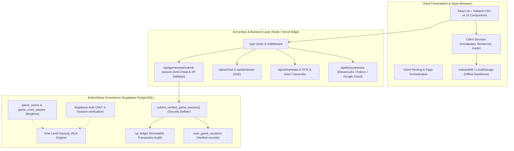

# HENGLISH ACADEMY — COMPLETE APPLICATION ARCHITECTURE AUDIT & SPECIFICATION

**Version:** 2.5 (GameVerse & Secure Backend Architecture)  
**Date:** November 2026  
**Status:** Production Standard  

---

## 1. System Overview & Architectural Tenets

Henglish Academy is built upon a resilient, modern, multi-tier architecture separating the **Presentation & Client Experience layer**, the **Stateless Backend Service layer**, and the **Authoritative PostgreSQL Database layer (Supabase)**.

---

## 2. Complete Inventory: Frontend vs Backend Responsibilities

| Subsystem | Frontend Responsibilities | Backend Responsibilities | Database / Persistence |
| :--- | :--- | :--- | :--- |
| **Authentication** | Login/Register UI, OAuth redirects, JWT storage, guest session migration | JWT token validation, refresh token rotation | `auth.users`, `public.profiles` |
| **Henglish GameVerse** | Game HUD, interactive tiles, progressive clue reveals, speech playback, local timer | Anti-cheat duration check, accuracy clamping, verified XP calculation, idempotency validation | `gameverse_definitions`, `user_game_sessions`, `xp_ledger` |
| **Gamification & XP** | Optimistic UI feedback, streak combos, celebratory confetti | Authoritative XP transaction creation, daily limits, duplicate prevention | `xp_ledger` (immutable), `profiles.xp` |
| **Multiplayer 1v1 & Rooms** | Room code input/copy, ready check status, turn synchronization | Room validation, participant verification, round synchronization | `game_rooms`, `game_room_players` (Supabase Realtime) |
| **AI Tutor & Duels** | Chat interface, conversation state, audio streaming player | Prompt composition, Gemini/OpenAI API dispatch, rate limiting (IP-based) | `ai_conversations`, `ai_messages` |
| **Translation Studio** | Source text input, camera snapshot, voice recorder | Model invocation, OCR text extraction, audio transcription | `translations_history`, `translation_favorites` |
| **Video & Movie Studio** | Video player (YouTube IFrame), category browsing, search history | YouTube Data API proxy, oEmbed validation, fallback catalog | `saved_videos`, `video_library_metadata` |
| **Vocabulary & Sentences** | Fast in-memory indexed filtering, CEFR navigation, audio pronunciation | Static asset delivery (Gzip/Brotli compressed JSON datasets) | `dictionary_words`, `public/data/` |

---

## 3. Security, Anti-Cheat, and Environment Isolation

### 3.1 Environment Variable Classification & Audit

| Variable | Scope | Target Layer | Exposure Risk |
| :--- | :--- | :--- | :--- |
| `VITE_SUPABASE_URL` | Client & Server | Browser (`import.meta.env`) | **Public** (Protected by RLS) |
| `VITE_SUPABASE_ANON_KEY` | Client & Server | Browser (`import.meta.env`) | **Public** (Protected by RLS) |
| `SUPABASE_SERVICE_ROLE_KEY` | **Server Only** | Serverless API / Edge | **Privileged Secret** (Never exposed to browser) |
| `GEMINI_API_KEY` | **Server Only** | AI Backend Service | **Privileged Secret** (Never exposed to browser) |
| `OPENAI_API_KEY` | **Server Only** | AI Backend Service | **Privileged Secret** (Never exposed to browser) |
| `ELEVENLABS_API_KEY` | **Server Only** | TTS Audio Service | **Privileged Secret** (Never exposed to browser) |
| `GOOGLE_TTS_API_KEY` | **Server Only** | TTS Audio Service | **Privileged Secret** (Never exposed to browser) |

### 3.2 Anti-Cheat XP Mechanism

1. **Client Submission Isolation:**  
   Clients never send `xpToAward` directly. They submit `score`, `maxScore`, `accuracy`, and `durationSeconds`.
2. **Speed & Duration Heuristics:**  
   If an 8-question round with high score is submitted in under 3 seconds (`durationSeconds < 3`), the backend flags the transaction as `impossible_speed_detected` and awards 0 XP.
3. **Idempotency Keys:**  
   Every session submission carries a unique cryptographic idempotency key (`sess_<gameId>_<timestamp>_<nonce>`). Submitting the same key multiple times returns the cached verified transaction without duplicating XP.
4. **Immutable Transaction Ledger (`xp_ledger`):**  
   Every verified XP reward writes an immutable ledger entry. No `INSERT` or `UPDATE` policy exists for standard authenticated users on `xp_ledger`. Inserts are executed exclusively by the `SECURITY DEFINER` function `submit_verified_game_session()`.

---

## 4. GameVerse Architecture & 8-Category Taxonomy

Henglish GameVerse is structured into 8 distinct learning and competitive categories:

1. **Vocabulary:**
   - *Vocabulary Rush (`vocab-rush`):* High-speed lexical recall under 30-second time pressure with dual US/UK pronunciation.
   - *Word Detective (`word-detective`):* 3-tier contextual clue deduction rewarding fewer clues used.
   - *Spelling Bee (`spelling-bee`):* Auditory spelling challenge with IPA phonetic guidance.
   - *Synonym & Antonym Arena (`synonym-hunter`):* Nuanced semantic distractor challenge.
2. **Grammar:**
   - *Sentence Builder (`sentence-builder`):* Interactive syntactic tile builder fed dynamically by 5,500 real sentences.
   - *Error Hunter (`error-hunter`):* Diagnostic grammar auditor spotting subtle tense, conditional, and preposition faults.
   - *V3 Irregular Verbs Blitz (`v3-blitz`):* Rapid-fire past participle recall.
   - *Grammar Tower (`grammar-tower`):* Progressive challenge advancing through CEFR tiers.
3. **Listening:**
   - *Listening Detective (`listening-detective`):* Auditory detail extraction with dialect distinction (UK vs US).
4. **Speaking & Pronunciation:**
   - *Pronunciation Arena (`pronunciation-challenge`):* Minimal pairs and phonetic clarity training.
5. **Reading & Comprehension:**
   - *Reading Detective (`reading-speedster`):* Short passage inference and main idea extraction.
6. **Writing:**
   - *Sentence Correction & Guided Syntax:* Error identification and rewrite challenges.
7. **Adventure & Story:**
   - *Contextual Dialogue Missions:* Real-life dialogues across everyday scenarios.
8. **Competitive & Multiplayer:**
   - *AI Opponent Duel 1v1 (`ai-duel`):* Deterministic skill-based AI bots (`Sparky`, `Byte`, `Nexus`, `Titan`) with realistic latency and accuracy profiles.
   - *Live Multiplayer Room (`multiplayer-arena`):* Realtime 6-character room codes for synchronized peer challenges.

---

## 5. Database Schema & RLS Matrix

### `gameverse_definitions`
- **Purpose:** Stores definitions, CEFR bounds, base XP, and mechanics of all educational games.
- **RLS:** Public read-only (`is_active = TRUE`).

### `user_game_sessions`
- **Purpose:** Authoritative history of completed challenges, scores, durations, and verification flags.
- **RLS:** Users can only `SELECT` and `INSERT` rows where `auth.uid() = user_id`.

### `xp_ledger`
- **Purpose:** Immutable audit trail for XP gains preventing replay and tampering.
- **RLS:** `SELECT` allowed for `auth.uid() = user_id`. Direct client `INSERT`/`UPDATE` is blocked; writes happen via RPC.

### `game_rooms` & `game_room_players`
- **Purpose:** Supabase Realtime rooms with 6-character room codes.
- **RLS:** Open rooms viewable by authenticated users; updates restricted to host or room members.

---

## 6. Verification and Compliance

- **TypeScript Type Safety:** 100% strict typing with zero `any` or suppression directives.
- **Bundle & Build Integrity:** Production Vite build verified with zero bundle errors.
- **Responsive Standard:** Tested across 320px, 375px, 768px, 1024px, and desktop breakpoints with full RTL Arabic support.
