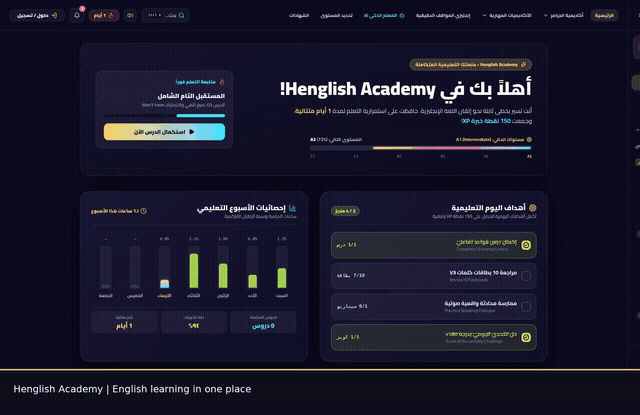

# Henglish Academy | هناوي إنجلش

[Open the live site](https://henglish.pages.dev/)

An Arabic-first English learning platform: grammar explanations, vocabulary, real-life conversations and practice in one place. "Learn it. Use it. Own it."

## Live walkthrough



[Watch or download the MP4 recording](docs/demo/walkthrough.mp4). Two-voice Egyptian-Arabic narrated walkthrough, recorded from the live site on November 15, 2026; the interface may change as development continues.

## Features

- Grammar lessons and skill academies for reading, writing, listening, speaking and pronunciation.
- Vocabulary practice, a sentence library and lessons built around film/series clips.
- Real-life scenario practice, exercises, placement tests and learning notes.
- A 3D learning world and AI-related tools. AI/provider features depend on configuration and provider availability.
- Guest access plus account/profile settings, Google sign-in and saved learning features through the Hono API.
- Certificate screens are platform-issued learning records, not a claim of third-party accreditation.

## Stack

React, TypeScript, Tailwind CSS, Framer Motion and Three.js. The repository contains both the Vite application and Next.js static-export routes. The account API is Hono on Cloudflare Workers with D1; legacy Supabase integrations remain in the source.

## Run locally

Use a current Node.js LTS release compatible with `package.json`.

```bash
npm install
npm run dev           # Vite, http://localhost:5173
npm run build         # TypeScript + Vite, dist/
npm run preview       # preview Vite output
```

The Next.js route build is a separate workflow:

```bash
npm run dev:next
npm run build:next    # static export in out/
```

Choose the build command and output folder that match the deployment. Do not interchange `dist/` and `out/`.

## Accounts and configuration

`backend/` contains the Hono API, D1 migrations and Google OAuth implementation. For local API development:

```bash
cd backend
npm install
npm run db:migrate:local
npm run dev
npm run typecheck
```

Configure API URLs and provider credentials in the hosting environment. Google OAuth secrets and private API keys belong on the server, never in client bundles or git. A frontend-only checkout does not supply a working AI provider or production account database.

## Repository map

- `src/views/`: the learning screens.
- `src/components/`: navigation, lesson UI and shared controls.
- `src/data/`: learning content.
- `src/services/` and `src/context/`: integrations and app state.
- `src/app/`: Next.js route wrappers.
- `backend/`: account API and D1 migrations.

Content and game features are changing actively. This README describes the checked-in implementation rather than promising a fixed lesson count or future features.
