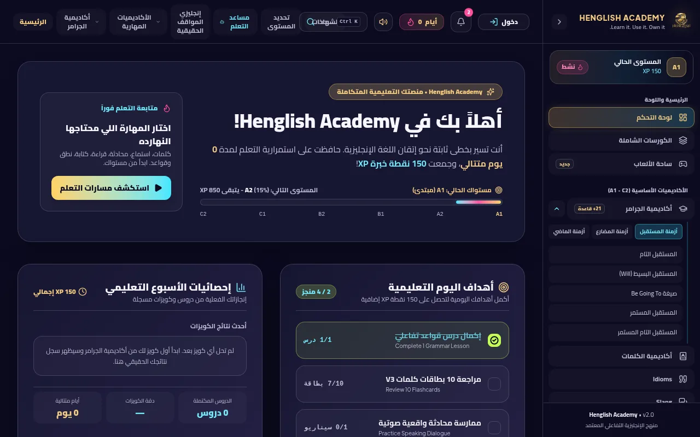
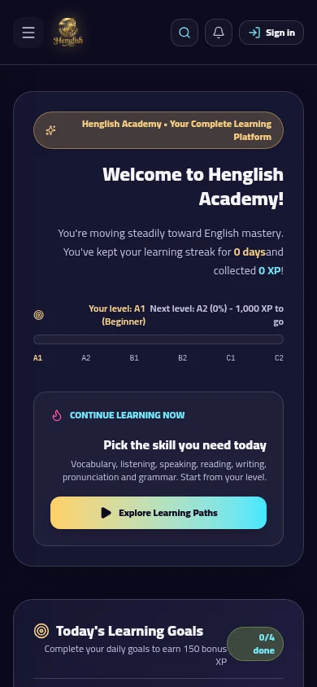

<div align="center">

# 🦅 Henglish Academy · أكاديمية هناوي إنجلش

### "Learn it. Use it. Own it."

منصة شاملة لتعلم الإنجليزية بالمصري: كلمات وقواعد، استماع ومحادثة، قراءة وكتابة ونطق،
أفلام وألعاب ومواقف وعالم ثلاثي الأبعاد واختبارات.

[](https://henglish.pages.dev)
[](https://react.dev)
[](https://www.typescriptlang.org)
[](https://threejs.org)
[](https://supabase.com)

[](https://henglish.pages.dev)

**[افتح الأكاديمية ←](https://henglish.pages.dev)**

</div>

---

## Development and production

Next.js 15 static export on free Cloudflare Pages. Run `npm run dev`, `npm run build`, then `npm run preview`. Deploy `out/`. See [build and deployment notes](docs/next-production-build.md).
## جولة من الموقع الحالي

صور مباشرة من الموقع يوم 18 نوفمبر 2026. الجولة المتحركة بتعرض لوحة البداية، الكورسات، وأكاديمية الجرامر. دي لقطات من التنقل الفعلي، مش واجهة مرسومة.

[](https://henglish.pages.dev)

| الكمبيوتر | الموبايل |
| --- | --- |
|  |  |

[الكورسات](https://henglish.pages.dev/#courses) · [أكاديمية الجرامر](https://henglish.pages.dev/#grammar)

## 🌟 نظرة عامة

هناوي إنجلش أكاديمية تجمع مهارات اللغة والتطبيق اليومي في مكان واحد. اختار المهارة اللي
محتاجها، اتعلم من أمثلة وحوارات، وراجع بالتدريبات والألعاب. كورسات الجرامر جزء من
التجربة، جنب الكلمات والاستماع والمحادثة والقراءة والكتابة والنطق.

---

## ✨ أركان المنصة

### 1. 📚 أكاديمية القواعد الكاملة

- **59 قاعدة في أكاديمية الجرامر** لكل قاعدة لغوية بدلاً من مجرد كروت ملخصة.
- يغطي المنهج المضارع والماضي والمستقبل بكل صورهم، الحالات الشرطية الأربع، الأفعال
  الناقصة، المبني للمجهول، الكلام المنقول وجمل الوصل.
- كل صفحة فيها أهداف الدرس والمستوى (CEFR)، مخطط زمني تفاعلي، التراكيب الأربعة
  (إثبات/نفي/سؤال/إجابات قصيرة)، شرح بالمصري، مقارنات بين الأزمنة المتشابهة، فخاخ
  الأخطاء الشائعة، وتدريب فوري مع تتبع إتمام الدرس.

### 2. 🎬 مكتبة الفيديو المعتمدة

- مشغل يوتيوب مدمج متجاوب لكل درس، بقنوات تعليمية عالمية مختارة بعناية.
- اسم القناة، مدة الفيديو، الوصف، وأزرار طوابع زمنية مباشرة لأهم فقرات الشرح.

### 3. 🧠 المعلم التفاعلي الذكي

- مدرس إنجليزي تفاعلي بـ **7 أوضاع تخصصية**: مدرس قواعد، شريك محادثة، مدرب مفردات،
  مساعد كتابة، مدرب نطق (IPA)، مدرب آيلتس وتوفل، ومحاكي مقابلات عمل بأسلوب STAR.
- عقل تعليمي محلي يعمل فوراً بكامل كفاءته دون أي مفاتيح خارجية، مع دعم اختياري
  لمزودين سحابيين.

### 4. 🏙️ العالم الافتراضي ثلاثي الأبعاد

- مدينة تعليمية نيونية بـ WebGL (Three.js) فيها 6 مبانٍ: المطار، المطعم، العيادة،
  برج الأعمال، الأكاديمية، والسينما التعليمية.
- كاميرا مدارية، مؤشرات متوهجة، ونقر مباشر للدخول إلى سيناريوهات المحاكاة، مع بديل
  خفيف ثنائي الأبعاد للأجهزة الضعيفة.

### 5. 🎭 محاكي المواقف الواقعية

- سيناريوهات متفرعة: مطار هيثرو، مطعم راقٍ، عيادة الطبيب، مقابلة توظيف تقنية.
- تقييم فوري للردود (+30XP / +15XP / +5XP)، إجابة حرة، وقاموس بقاء لكل سيناريو.

### 6. 🎙️ محرك الصوت والنطق

- أصوات طبيعية نقية (أمريكي وبريطاني، ذكوري وأنثوي) مع معايرة الطبقة والنبرة.
- نافذة إعدادات كاملة: اللكنة، سرعة النطق (0.75x إلى 1.25x)، كتم المؤثرات، واستماع تجريبي.

### 7. 📝 بنك الأسئلة وتحديد المستوى المتكيف

- مئات الأسئلة المتدرجة من A1 حتى C1 تغطي القواعد والمفردات والقراءة والاستماع.
- اختبار تحديد مستوى ديناميكي بجلسات غير مكررة، تقييم تفصيلي، رادار لنقاط القوة
  والضعف، ومسار تعليمي مقترح.

### 8. 📜 الشهادات والتحقق العام

- شهادات إنجاز قابلة للطباعة والتنزيل PDF.
- محرك تحقق عام برمز مشفر فريد (مثل `HENG-GRM-2026-X892`).
- إخلاء طرف واضح: الشهادة تعكس إنجاز الطالب داخل المنصة وليست بديلاً عن الاختبارات الدولية.

### 9. 🔐 الحسابات ووضع الضيف

- تسجيل بالبريد وكلمة المرور عبر Supabase.
- **وضع ضيف كامل** مع ترحيل ذكي للتقدم المحلي عند إنشاء حساب.
- حسابات تجريبية: `student@henglish.academy` و `teacher@henglish.academy`.

### 10. 🗄️ قاعدة البيانات والأمان

- مخطط PostgreSQL شامل (12 جدولاً علائقياً) في `supabase/migrations/`.
- **Row-Level Security** مفعّل على كل الجداول لخصوصية بيانات كل طالب.

### 11. 🌐 محرك الاتجاهين RTL/LTR

- عزل كامل للإنجليزية داخل الواجهة العربية: حقول إدخال LTR، بناء جمل من اليسار
  لليمين، `unicode-bidi: isolate` ضد تشوه الترقيم، وكشف تلقائي `dir="auto"`.

---

## 🛠️ البنية التقنية

| التقنية | الاستخدام |
| :-- | :-- |
| **React 19 + TypeScript (Strict)** | الواجهات والتوجيه بين 24 مساراً |
| **Vite** | التطوير والبناء مع تقسيم الحزم |
| **Tailwind CSS v4** | نظام التصميم النيوني المتجاوب |
| **Three.js** | العالم ثلاثي الأبعاد WebGL |
| **Framer Motion** | الحركات والنوافذ المنبثقة |
| **Web Speech & Web Audio APIs** | محرك النطق والمؤثرات |
| **Supabase / PostgreSQL** | الحسابات وقاعدة البيانات مع RLS |

---

## 🚀 التشغيل محلياً

```bash
pnpm install
cp .env.example .env   # اختياري - المنصة تعمل بالكامل بدون مفاتيح
pnpm dev               # http://localhost:5173/
pnpm exec tsc --noEmit
pnpm run build
```

ينتشر المشروع كتطبيق صفحة واحدة (SPA) على **Cloudflare Pages**:
[henglish.pages.dev](https://henglish.pages.dev).

---

## 💡 فلسفة هناوي التعليمية

> **"اللغة الإنجليزية ليست مادة للحفظ بل مهارة للتعبير وصناعة الفرص العالمية."**

- افهم الفكرة والموقف الحياتي قبل حفظ القاعدة.
- تدرب مع المعلم التفاعلي والمواقف الواقعية دون خوف من الخطأ.
- استمع للنطق النقي وكرر العبارات بصوت مسموع.

---

<div align="center">

**حقوق التطوير والملكية © 2026 أكاديمية هناوي إنجلش (Henglish Academy). جميع الحقوق محفوظة.**

Made with care by **Mohamed Alhinawi** · [henglish.pages.dev](https://henglish.pages.dev)

</div>
